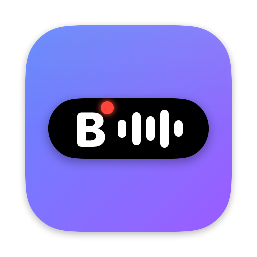

<p align="center"></p>

# BeeDott — локальный auto-followupper для встреч

> Бывший MeetMind. Новое имя видно в `/Applications/BeeDott.app`, Finder и уведомлениях;
> внутренние пути (`~/MeetMind`, `~/Library/Application Support/MeetMind`), bundle id
> и имена модулей пока прежние, чтобы не потерять данные и настройки.

Локально (на твоём Mac) записывает встречи Zoom/Meet/Teams, транскрибирует
аудио через MLX-Whisper, собирает фоллоу-ап через **Claude Opus**
(`claude -p` по Max-подписке или Anthropic API по ключу), потом отправляет
его в Telegram + сохраняет в Markdown / Obsidian.

---

## Быстрый старт

Требования: macOS Apple Silicon (M-серия), Python 3.11+, Homebrew.

```bash
git clone <repo> && cd meetmind
./setup_mac.sh                          # установит BlackHole и зависимости
# заполнить .env (см. ниже)
source .venv/bin/activate
python main.py                          # стартует с menubar-иконкой
```

В `.env` минимально надо:

```env
# Если есть Max-подписка (рекомендуется — Opus без отдельной оплаты)
SUMMARY_BACKEND=claude_cli
CLAUDE_CODE_MODEL=opus

# ИЛИ через Anthropic API (отдельный биллинг)
# SUMMARY_BACKEND=api
# ANTHROPIC_API_KEY=sk-ant-...

TELEGRAM_BOT_TOKEN=...                  # @BotFather
TELEGRAM_CHAT_ID=...                    # @userinfobot
```

Остальное по желанию (Obsidian vault, Notion DB и т.д.) — см. `.env.example`.

## Два способа вызвать Claude

Саммари всегда делает Claude Opus. Способ — `SUMMARY_BACKEND` в `.env`:

| `SUMMARY_BACKEND` | Когда | Что нужно |
|---|---|---|
| `claude_cli` (по умолчанию) | Есть Max-подписка | `claude` в PATH (или `MEETMIND_CLAUDE_BIN`), `claude login` |
| `api` | Нет Max, есть API-ключ | `ANTHROPIC_API_KEY=sk-ant-...`, модель — `ANTHROPIC_MODEL` (`claude-opus-5`) |

Claude Code CLI — рекомендуемый путь для Max-подписчиков: через CLI получаешь
Opus без отдельной оплаты токенов. Установка CLI:
`npm install -g @anthropic-ai/claude-code` → `claude login`.

---

## Архитектура

```
                            ┌──── Calendar ──┐
                            ├── ProcessWatch ├──▶ Recorder ──▶ WAV
   Триггеры (любой)         └── Menubar/⌘⇧R ─┘  (BlackHole+Mic
                                                 Aggregate Device)
                                                       │
                                                       ▼
                                              MLX-Whisper large-v3
                                                       │
                                              сегменты транскрипта
                                                       │
                                                       ▼
                                 Claude Opus (claude -p | Anthropic API)
                                                       │
                                              followup.json / .md
                                                       │
              ┌──────────────┬────────────────┬────────┴──────┐
              ▼              ▼                ▼               ▼
          Telegram      ~/MeetMind/      Obsidian vault    Notion DB
                        YYYY-MM-DD/
```

## Что делает каждый компонент

| Файл | Что |
|---|---|
| `daemon/recorder.py` | sounddevice + Aggregate Device («MeetMind In» = BlackHole+Mic). Fallback на BlackHole, затем на дефолтный мик |
| `daemon/transcriber.py` | MLX-Whisper large-v3 на Metal. Fallback на openai-whisper |
| `daemon/summarizer.py` | Промпт, JSON-схема и валидация фоллоу-апа; вызов — `daemon/claude_cli.py` (`claude -p`) или `daemon/anthropic_api.py` (Anthropic SDK) |
| `daemon/sinks/markdown.py` | `~/MeetMind/2026-05-26/HHMM-title.md` |
| `daemon/sinks/telegram.py` | python-telegram-bot v22 async. Шлёт два сообщения: 🖥 локальный + ☁ облачный |
| `daemon/sinks/obsidian.py` | Markdown с frontmatter в твой vault |
| `daemon/sinks/notion.py` | REST API, создаёт новую страницу в указанной БД |
| `daemon/scheduler.py` | Поллит Google Calendar каждые 2 мин, стартует запись за ~5 мин до встречи |
| `daemon/process_watcher.py` | psutil — детектит запуск `zoom.us` процесса |
| `tray.py` | rumps menubar + global hotkey ⌘⇧R |

## Триггеры записи

Все три работают одновременно. Любой может стартануть запись:

1. **Google Calendar** — события из календаря с пометкой времени.
2. **Process watcher** — psutil смотрит, не запустился ли `zoom.us`/etc.
3. **Menubar / Hotkey ⌘⇧R** — ручной старт.

Когда триггер сработал, идёт запись. Стоп: либо тот же триггер (процесс
закрылся, новый календарь не наступил), либо ⌘⇧R, либо «Остановить запись»
в menubar, либо WS-событие `meeting_end` от Firefox extension.

## Sinks

Все sinks работают параллельно. Если sink не настроен или упал — остальные
продолжают. Каждый sink возвращает `SinkResult`, логи показывают что куда
ушло.

## Setup Aggregate Device (важно)

Чтобы писать **и** свой голос, **и** собеседников — нужно одно устройство
с обоими источниками. macOS делает это через Audio MIDI Setup:

```
open -a "Audio MIDI Setup"
→ +  →  Create Aggregate Device
→ ✓ Built-in Microphone
→ ✓ BlackHole 2ch
→ переименуй в "MeetMind In"
```

Чтобы **слышать** собеседников при этом — отдельный Multi-Output Device:

```
+  →  Create Multi-Output Device
→ ✓ Built-in Output (или наушники)
→ ✓ BlackHole 2ch
→ выбери его в Системные настройки → Звук → Output перед звонком
```

Если Aggregate не настроен — MeetMind напишет только системный звук
(собеседников, без тебя). Если и BlackHole не установлен — только микрофон.

## Юридическое примечание

Запись разговора без явного согласия собеседников может нарушать законы:
**РФ** (ст. 137 УК), **GDPR** в ЕС, в США двух-сторонний consent в
CA/FL/IL/MD/MA/MT/NV/NH/PA/WA. MeetMind хранит всё **только локально** и не
загружает аудио в облако (только текст транскрипта идёт в Claude API если
включён). Уведомлять собеседников — твоя ответственность.

## Файлы и куда что попадает

```
~/AIApp/meetmind/
  sessions/
    <session_id>/
      <session_id>.wav            # сырое аудио
  ~/MeetMind/                     # MARKDOWN_BASE_DIR
    2026-05-26/
      1430-call-with-team.md      # combined followup
  <Obsidian vault>/Meetings/2026-05-26/...
  Notion DB — новые страницы с заголовком встречи
```

## Установка приложения

```bash
app/install.sh                 # собрать BeeDott.app и поставить в /Applications
app/Tools/app_icon.sh          # перерисовать иконку (по умолчанию islandLetter), потом снова install.sh
```

`install.sh` не ставится, пока идёт запись или обработка (`FORCE=1` — всё
равно). Путь к репо сохраняется в настройках приложения, демон стартует из
репо и при запуске из `/Applications`. Автозапуск — через «Объекты входа».

**Коллегам (чистый Mac, без репо и терминала):** `app/package.sh` собирает
`app/build/BeeDott.zip`, инструкция — [docs/INSTALL.md](docs/INSTALL.md). При
первом запуске мастер сам ставит Python-пакеты и модель Whisper в
`~/Library/Application Support/MeetMind/runtime`, спрашивает ключ Anthropic и
по желанию подключает Telegram. Повторно — меню → «Настройка…».

## Запуск как сервис

`launchd` plist можно положить в `~/Library/LaunchAgents/com.meetmind.plist`,
но проще — открыть терминал и держать `python main.py` запущенным. С
menubar это удобно. Для перезапуска просто `⌘Q` в menubar.

## Известные ограничения

- Только macOS Apple Silicon
- Diarization (определение кто говорит из аудио) пока не реализовано — имена
  спикеров берутся только из Firefox extension для Google Meet
- Real-time транскрипция не делается — Whisper гоняется после записи

## Лицензия

MIT
